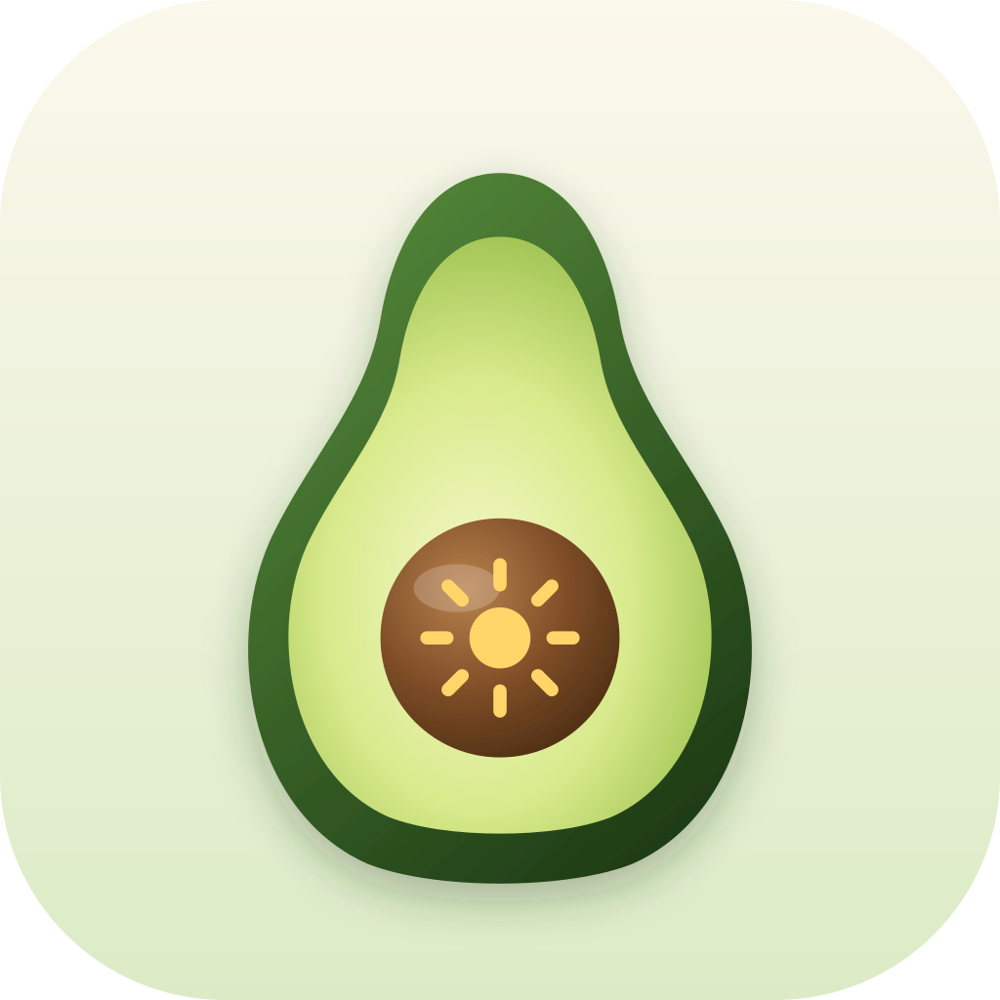

<p align="center"></p>

<h1 align="center">avocado-keep-awake</h1>

**Keep your Mac awake from [herdr](https://herdr.dev): always, only while an agent is working, or never.**
Long agent runs keep going when you step away, and the Mac still sleeps normally once they're done.

| | |
|---|---|
| **Modes** | **On**: keep the computer awake. **Agent**: stay awake while a herdr agent is working (default). **Off**: normal sleep |
| **Where** | A small picker panel, herdr actions with toasts, an optional tab bar badge, and a CLI |
| **How** | One `caffeinate -i` process, tied to the herdr server so it never outlives it |
| **Needs** | macOS and herdr 0.9.3+. A single zsh script with no build step and nothing to download |

---

## Contents

- [Quick start](#quick-start)
- [The panel](#the-panel)
- [Themes](#themes)
- [Tab bar badge](#tab-bar-badge)
- [herdr actions](#herdr-actions)
- [CLI](#cli)
- [How it works](#how-it-works)
- [What it doesn't do](#what-it-doesnt-do)
- [State and privacy](#state-and-privacy)

---

## Quick start

```sh
herdr plugin install andymartinezot/avocado-keep-awake
```

The default mode is **Agent**, so nothing else is needed. To change the mode, open herdr's action
list and pick **Keep awake: choose mode**. To open it with a key instead, add this to
`~/.config/herdr/config.toml`, using a key that is free in your setup:

```toml
[[keys.command]]
key = "prefix+shift+k"
type = "plugin_action"
command = "andymartinezot.avocado-keep-awake.open-panel"
description = "avocado-keep-awake: keep the Mac awake"
```

Then run `herdr server reload-config`. herdr reads `config.toml` only when it starts, so the key
does nothing until you reload.

---

## The panel

```
 avocado-keep-awake                 Agent · Active

 Keep computer awake
 ────────────────────────────────────────────────
    On
     Keep this computer awake continuously

 ● ▸ Agent
     Stay awake while an agent is working

    Off
     Allow normal system sleep behavior

 ↑↓ move  ⏎ select  1-3 pick  esc close
```

The dot marks the current mode. The header shows the mode and whether the Mac is being held awake
right now, refreshed every second.

| Key | Action |
|---|---|
| `↑` `↓` / `k` `j` | Move |
| `⏎` / `space` | Choose the highlighted mode and close |
| `1` `2` `3` | Choose On, Agent or Off directly |
| `esc` / `q` | Close without changing anything |

Choosing a mode shows a toast, for example *Keep awake: Agent · Stay awake while an agent is
working · Active*.

---

## Themes

The panel uses the avocado palette shared with
[avocado-trope](https://github.com/andymartinezot/avocado-trope) and
[avocado-park](https://github.com/andymartinezot/avocado-park): `dracula` (default), `catppuccin`,
`tokyo-night`, `gruvbox`, `nord`, `classic` and `terminal`, with the same color for the same job in
every avocado plugin. The accent marks the title and keys, green means awake, and the muted color
marks the selected row.

It picks the first of:

1. `$AVOCADO_KEEP_AWAKE_THEME`, or `$AVOCADO_THEME` to set every avocado plugin at once
2. The theme you last switched to in avocado-trope (`t`), so both always match
3. herdr's own `[theme] name`. Names like `tokyo-night-storm` or `catppuccin-mocha` map to the
   matching theme, and light variants use `terminal`
4. `dracula`

`avocado-keep-awake theme` prints the one in use.

---

## Tab bar badge

To see at a glance that the Mac is being held awake, add a command entry to herdr's tab bar. It
prints `☕ On` or `☕ Agent` while the Mac is held awake, and nothing otherwise:

```toml
[ui]
tab_bar_right = [
  { type = "command", command = "~/.local/bin/avocado-keep-awake status --short", interval_seconds = 5, timeout_seconds = 2 },
]
```

Point `command` at the script: `bin/avocado-keep-awake` inside the plugin directory. You can link it
onto your `PATH` as shown, or use the full path.

---

## herdr actions

| Action | What it does |
|---|---|
| **Keep awake: choose mode** | Opens the panel |
| **Keep awake: next mode** | On → Agent → Off → On |
| **Keep awake: On** / **Agent** / **Off** | Sets that mode |

Bind any of them with `type = "plugin_action"` and the action id, for example
`andymartinezot.avocado-keep-awake.cycle`.

---

## CLI

```sh
avocado-keep-awake               # the panel
avocado-keep-awake status        # "Agent · Active" and how many agents are working
avocado-keep-awake status --short
avocado-keep-awake on|agent|off  # set the mode
avocado-keep-awake cycle
avocado-keep-awake sync          # bring caffeinate in line with the mode (herdr runs this for you)
avocado-keep-awake theme         # the color theme in use
```

---

## How it works

- **Awake** means one `caffeinate -i` process. It stops idle system sleep, and the display can still
  turn off. It runs with `-w <herdr server pid>`, so it exits when the herdr server does.
- **Agent mode** counts agents whose herdr status is `working`. herdr runs `sync` on startup,
  whenever an agent's status changes, and when a pane closes or exits. Agents that are `idle`,
  `done` or `blocked` waiting for you don't keep the Mac awake.
- Events can arrive in bursts, so `sync` takes a lock and there is never more than one
  `caffeinate`.

## What it doesn't do

- **Closing the lid still sleeps the Mac**, as with any `caffeinate`. Keep it open, or use an
  external display.
- It doesn't keep the display on. The screen can still lock on its normal schedule; that doesn't
  pause the agents.
- It doesn't change any system setting. Quitting herdr, or choosing **Off**, puts everything back.

## State and privacy

Two small files in the plugin's herdr config directory (`herdr plugin config-dir
andymartinezot.avocado-keep-awake`): `mode` and `caffeinate.pid`. No network, no other files, and
the only programs it runs are `herdr`, `caffeinate` and `ps`.

## License

[MIT](LICENSE)
